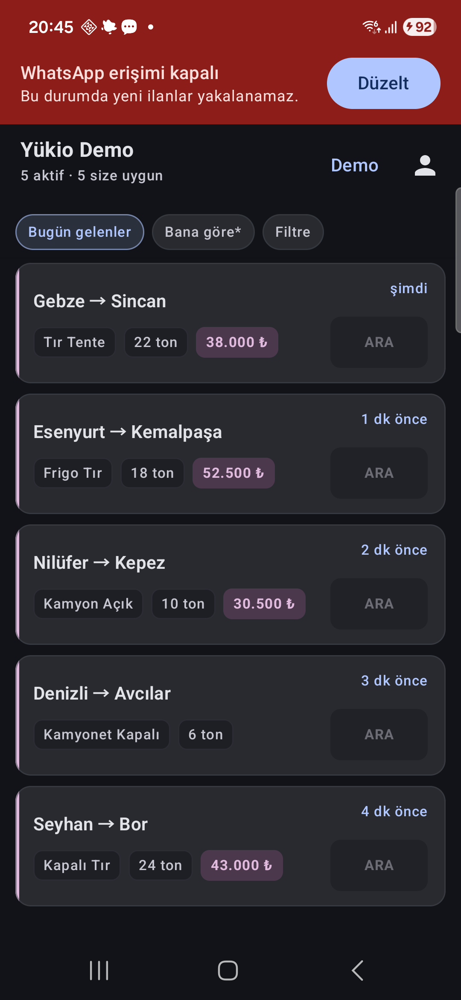
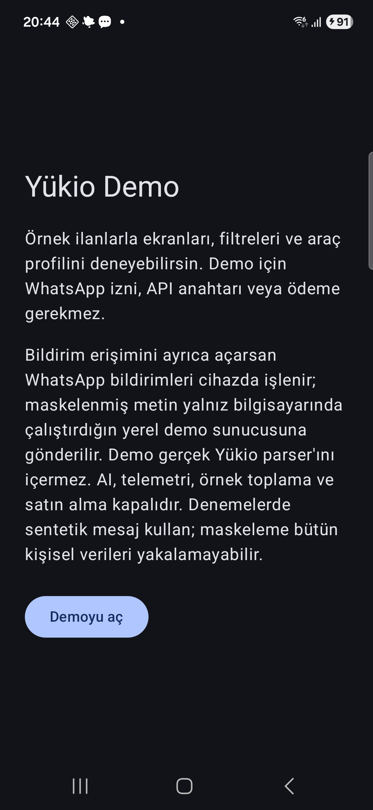

# Yükio — Android Demo

Yükio, lojistik ilanlarını araç ve güzergâh tercihlerine göre listeleyen Android uygulamasıdır.
Bu paylaşım sürümü uygulamanın arayüzünü, yerel veritabanını, filtrelerini ve bildirim akışını
incelemek içindir. Ticari ürünün özel parser'ı ve üretim backend'i bu depoda bulunmaz.

**API anahtarı, abonelik ve geliştiriciden erişim istemek gerekmez.** İlk açılışta beş
sentetik ilan görünür. WhatsApp veya bildirim izni vermeden listeyi ve profili deneyebilirsin.

## Ekran görüntüleri

 

Görseller önceki demo sürümüne aittir. v44 (1.0.8-demo) yeni ilan ve referans akışlarını ekler.


## Yayımlanmış APK

[**Yukio.apk indir**](https://github.com/Tekin4124/yukio-android-demo/releases/latest/download/Yukio.apk) · [Sürüm notları ve SHA-256](https://github.com/Tekin4124/yukio-android-demo/releases/latest)

Bağlantı son yayımlanan sürümü açar; v44 APK ayrıca hazırlanmıştır.
Android 8.0 ve üzeri. APK yerel debug anahtarıyla imzalanmış inceleme sürümüdür; üretim uygulaması değildir.

## Hızlı başlangıç

Android Studio'da projeyi aç, SDK 36 ve JDK 17 ile `app` debug sürümünü çalıştır.
Komut satırında:

```bash
./gradlew assembleDebug
```

Windows: `gradlew.bat assembleDebug`. Android SDK yolunu Android Studio ayarlar veya
Git'e alınmayan `local.properties` dosyasında `sdk.dir=...` olarak belirtebilirsin.
APK: `app/build/outputs/apk/debug/app-debug.apk`.

Demo uygulama kimliği `com.yukio.demo`; gerçek Yükio kurulumu ve verileriyle çakışmaz.

## v44: sunucusuz yeni akışlar

**İlan ekle → Örnek ekle → Kartları hazırla** ile başlayabilirsin.
Kartları seç, dokunarak düzenle ve onayla. Sonuçlar yalnız bu cihazın demo listesine eklenir.
İlanlarım sekmesinden yeniden düzenleyebilir veya kaldırabilirsin. Aynı yük ikinci kez eklenmez;
karışık mesajlarda yalnız yeni kartlar eklenir. Kayıtlar 24 saat sonra görünmez; uygulama yeniden
başlatıldığında korunur. Yeni ilan sınırı cihaz başına son 60 saniyede 150'dir; günlük sınır yoktur.

Telefon metinden alınır; eksikse onaydan önce istenir. Demo **yalnız** aranamayan
`0000 000 00 01`–`0000 000 00 99` örnek numaralarını kabul eder. Arama kapalıdır.
Bu ekrandaki küçük örnek ayrıştırıcı aşağıdaki açık `ŞEHİR -> ŞEHİR | ...` biçimini kullanır;
üretim parser'ı değildir, serbest WhatsApp mesajlarını çözmez.

**Profil → Arkadaşını davet et → Kod kullan** ekranında `DEMO-FRIEND` girildiğinde
iki sanal hesaba birer kez 14 gün eklenmesi gösterilir. Kendi kodun `DEMO-MINE` kabul edilmez.
Bu yalnız arayüz simülasyonudur; gerçek üyelik, ortaklık kodu veya premium hakkı oluşturmaz.
İlan ve referans örnekleri cihaz verilerini temizleme ayarıyla sıfırlanır.

## Yerel örnek backend — isteğe bağlı

Python 3.10 veya üzeri yeterli; ek paket kurulumu yok:

```bash
python3 demo-backend/server.py
```

Windows: `py demo-backend/server.py`.
Bilgisayarda `http://127.0.0.1:3000` adresini açarak örnek mesajları deneyebilirsin.
Sunucu yalnız bilgisayarın yerel arayüzünde dinler; internete açmayın.

Android uygulamasından denemek için cihazı USB ile bağla veya emülatör aç:

```bash
adb reverse tcp:3000 tcp:3000
```

Uygulamada ana ekranın sağ üstündeki **API** düğmesine bas, örnek metni gönder ve
listeye dön. Mesaj yerel backend'e gider; üretilen ilanlar uygulamanın Room veritabanına
kaydolur. WhatsApp izni gerekmez.

Emülatörde alternatif: `./gradlew assembleDebug -PDEMO_BASE_URL=http://10.0.2.2:3000/`.
Port değişirse sunucuyu `--port 3001` ile çalıştır; derleme adresini ve adb reverse
portlarını birlikte değiştir. Demo derlemesi dış sunucu adreslerini kabul etmez.

## Örnek mesaj biçimi

```text
İSTANBUL -> ANKARA | TIR | 20 ton | 18000 TL
BURSA -> İZMİR | KAMYON | 8 ton | 9000 TL
```

Her satır ayrı bir ilan. Desteklenen şehirler: İstanbul, Ankara, İzmir, Bursa,
Antalya, Konya, Adana, Mersin, Kocaeli, Samsun, Tekirdağ ve Trabzon.
Araç, tonaj ve fiyat isteğe bağlı; `->` veya `→` ile açık kaynak/hedef yazılmalıdır.

**Bu sunucu gerçek parser'ın kalitesini temsil etmez.** Serbest WhatsApp mesajı,
ilçe, ortak başlık, karmaşık çok durak, belirsiz araç ve AI fallback desteklenmez.
Amaç API → ilan dönüşümü → veritabanı → ekran akışını çalıştırmaktır.
İletişim numarası üretilmez; gerçek kişisel mesajları kullanmayın.

## Neler incelenebilir?

- Jetpack Compose ile ilan listesi, detay, araç profili ve açık/koyu tema.
- Room yerel veritabanı, filtreler, sıralama ve profil uygunluğu.
- Sunucusuz ilan önizleme, onay, düzenleme, tekrar kontrolü ve yerel kalıcılık.
- İki sanal hesapla referans / 14 günlük ödül simülasyonu.
- İsteğe bağlı Retrofit örnek parser sözleşmesi ve çoklu ilan cevabı.
- İsteğe bağlı WhatsApp bildirim dinleyicisi, maskeleme ve retry.
- Yerel veri temizleme ve bildirim sağlık ayarları.

Demo sürümünde satın alma, üretim erişim token'ı, AI çağrısı, Play güncellemesi,
telemetri ve parser örneği toplama çalıştırılmaz. Harita mevcut kullanıcı akışında
aktif değildir; konum izni istenmez. Geliştirme dosyalarında kullanılan dahili
`com.example.test` namespace'i korunmuştur; paket kimliği ayrıdır.

## Dosya yapısı

```text
app/                  Android istemcisi ve testler
  src/main/.../ui/    Liste, profil ve demo mesaj ekranları
  src/main/.../data/  Room, tercihler ve Retrofit modelleri
  src/main/.../notification/ Bildirim, dönüşüm ve retry
  src/main/.../ai/    Kurallı profil eşleştirmesi
  src/main/.../billing/ Demo erişim durumu ve arayüz modelleri
  src/debug/          Yalnız yerel HTTP izni
 demo-backend/        Bağımsız, basit Python örnek API
 tools/               Paylaşım içeriği kontrolü
```

## Testler

```bash
python3 -m unittest discover -s demo-backend -p 'test_*.py'
python3 tools/check-public-package.py
./gradlew testDebugUnitTest assembleDebug
```

Bildirim erişimini ancak akışı ayrıca denemek istersen aç. Android arka plan
kısıtlamaları nedeniyle gerçek bildirim teslimatı cihaz koşullarına bağlıdır.
Demo varsayılan örneklerle bu izin olmadan kullanılabilir.

Güvenlik kapsamı: [SECURITY.md](SECURITY.md). Örnek API sözleşmesi:
[docs/DEMO-API.md](docs/DEMO-API.md).
